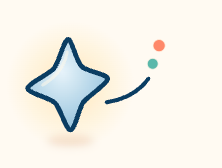

  

<h1 align="center">Stellisle · 知屿星信</h1>

  <strong>A quiet desktop companion engineered for macOS on Apple Silicon.</strong> 
  <em>为静谧思绪而生的桌面伴侣，与你共度屏幕前的微光晨昏。</em>

   &nbsp;
   &nbsp;
   &nbsp;
  
   
   &nbsp;
   &nbsp;
   &nbsp;
  

  

---

### Philosophy

Stellisle stays quietly at the corner of your screen. Running locally on Apple Silicon, it pairs on-device neural inference with acoustic speech synthesis and an encrypted SQLite memory graph. Your conversations, memories, and personal reflections never leave your Mac.

---

### Repositories

| Repository | Visibility | Purpose |
| :--- | :--- | :--- |
| [**stellisle-releases**](https://github.com/stellisle-app/stellisle-releases) | `Public` | Official signed macOS release packages (`.dmg`), release manifests, architecture specifications, and verified changelogs. |
| [**stellisle-website**](https://github.com/stellisle-app/stellisle-website) | `Private` | Brand website, interactive Web Audio voice showroom, Starlight Plaza card generator, and Cloudflare Pages edge deployment. |
| [**stellisle-app**](https://github.com/stellisle-app/stellisle-app) | `Public` | Organization profile and ecosystem hub. |

---

### Key Capabilities

#### Local Apple Silicon Inference
Optimized directly for Apple Metal compute kernels and Unified Memory (M1–M4). Conversational interactions run on your hardware with no network telemetry sent to external servers.

#### Tactile Skeuomorphic Desk
The developer feedback interface models a physical teleprinter with mechanical paper feed kinematics and procedurally synthesized dot-matrix printer acoustics through the Web Audio API.

#### Encrypted Long-term Memory
User preferences, milestones, and conversation history are indexed in an encrypted local database, building shared familiarity over time.

---

### Community & Official Channels

All official communication and community accounts for Stellisle:

| Channel | Identifier | Link | Description |
| :--- | :--- | :--- | :--- |
| **Official Website** | `stellisle.pages.dev` | [Visit Portal](https://stellisle.pages.dev) | Interactive showcase, voice showroom, and web portal. |
| **Feedback Desk** | `/feedback.html` | [Open Postbox](https://stellisle.pages.dev/feedback.html) | Direct-to-developer feedback with printed ticket receipts. |
| **Updates & Field Notes** | `/updates.html` | [Read Notes](https://stellisle.pages.dev/updates.html) | Transparent development logs and release preparation. |
| **Discord Sanctuary** | `Stellisle Official` | [Join Server](https://discord.gg/S7yy7Pxue) | Bilingual discussion, keepsakes, and voice model previews. |
| **X (Twitter)** | `@stellisle_app` | [Follow @stellisle_app](https://x.com/stellisle_app) | Release announcements, product previews, and engineering notes. |
| **Bluesky** | `@stellisle.bsky.social` | [Follow Bluesky](https://bsky.app/profile/stellisle.bsky.social) | Open social updates and long-form development fragments. |
| **itch.io** | `stellisle` | [View Project](https://stellisle.itch.io/stellisle) | Independent software showcase and community releases. |
| **Reddit** | `u/stellisle` | [View Profile](https://www.reddit.com/user/stellisle/) | Discussions across r/LocalLLaMA and r/macapps. |
| **Direct Contact** | `stellisle@proton.me` | [Email Us](mailto:stellisle@proton.me) | Privacy inquiries, security reports, and direct developer correspondence. |

Upcoming channels in verification: 小红书 (`知屿星信 Stellisle`), 即刻 (`知屿星信`), Bilibili (`知屿星信_Official`).

---

  © 2026 Stellisle. Built with care for quiet minds.

